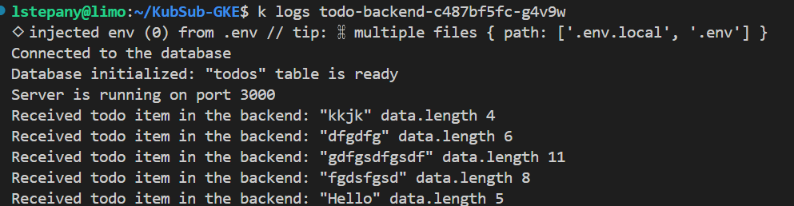
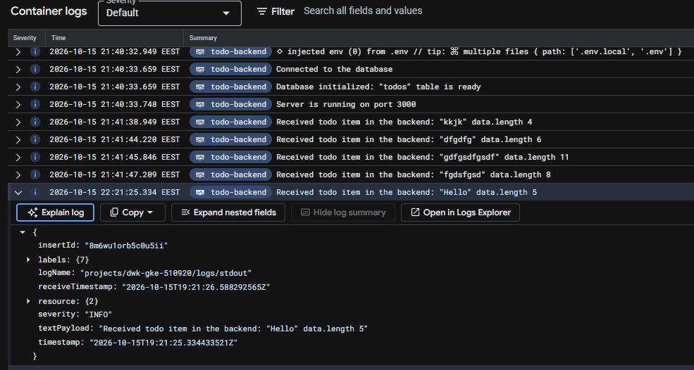

# KubernetesSubmissions

## Exercises

### Chapter 2

  - [1.1](https://github.com/levonml/KubernetesSubmissions/tree/1.1/log_outputs)
  - [1.2](https://github.com/levonml/KubernetesSubmissions/tree/1.2/the_project)
  - [1.3](https://github.com/levonml/KubernetesSubmissions/tree/1.3/log_outputs)
  - [1.4](https://github.com/levonml/KubernetesSubmissions/tree/1.4/the_project)
  - [1.5](https://github.com/levonml/KubernetesSubmissions/tree/1.5/the_project)
  - [1.6](https://github.com/levonml/KubernetesSubmissions/tree/1.6/the_project)
  - [1.7](https://github.com/levonml/KubernetesSubmissions/tree/1.7/log_outputs)
  - [1.8](https://github.com/levonml/KubernetesSubmissions/tree/1.8/the_project)
  - [1.9](https://github.com/levonml/KubernetesSubmissions/tree/1.9/pong-o)
  - [1.10](https://github.com/levonml/KubernetesSubmissions/tree/1.10/log_outputs)
  - [1.11](https://github.com/levonml/KubernetesSubmissions/tree/1.11)  
  - [1.12](https://github.com/levonml/KubernetesSubmissions/tree/1.12.1/the_project)
  - [1.13](https://github.com/levonml/KubernetesSubmissions/tree/1.13/the_project)

### Chapter 3

 - [2.1](https://github.com/levonml/KubernetesSubmissions/tree/2.1/log_outputs)
 - [2.2](https://github.com/levonml/KubernetesSubmissions/tree/2.2/the_project)
 - [2.3](https://github.com/levonml/KubernetesSubmissions/tree/2.3)
 - [2.4](https://github.com/levonml/KubernetesSubmissions/tree/2.4)
 - [2.5](https://github.com/levonml/KubernetesSubmissions/tree/2.5/log_outputs)
 - [2.6](https://github.com/levonml/KubernetesSubmissions/tree/2.6/the_project)
 - [2.7](https://github.com/levonml/KubernetesSubmissions/tree/2.7/pong-o)
 - [2.8](https://github.com/levonml/KubernetesSubmissions/tree/2.8/todo-backend)
 - [2.9](https://github.com/levonml/KubernetesSubmissions/tree/2.9/todo-backend)
 - [2.10](https://github.com/levonml/KubernetesSubmissions/tree/2.10/todo-backend)

### Chapter 4

- [3.1](https://github.com/levonml/KubernetesSubmissions/tree/3.1/ping-o)
- [3.2](https://github.com/levonml/KubernetesSubmissions/tree/3.2)
- [3.3](https://github.com/levonml/KubernetesSubmissions/tree/3.3)
- [3.4](https://github.com/levonml/KubernetesSubmissions/tree/3.4)
- [3.5](https://github.com/levonml/KubernetesSubmissions/tree/3.5/the_project)
- [3.6](https://github.com/levonml/KubernetesSubmissions/tree/3.6)
- [3.7](https://github.com/levonml/KubernetesSubmissions/tree/3.7)
- [3.8](https://github.com/levonml/KubernetesSubmissions/tree/3.8)
- [3.9](https://github.com/levonml/KubernetesSubmissions/tree/3.9)
- [3.10](https://github.com/levonml/KubernetesSubmissions/tree/3.10)
- [3.11](https://github.com/levonml/KubernetesSubmissions/tree/3.11)

##  3.12

